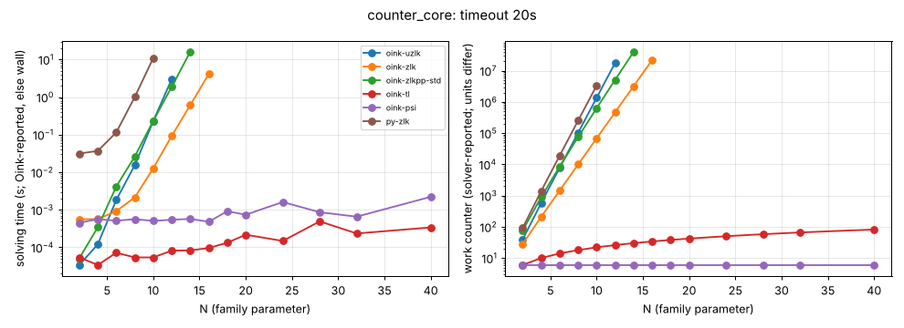

# counter_core

**Verdict:** CONFIRMED. The Zielonka variants blow up: uzlk b = 3.64, zlkpp-std 2.85, zlk 2.62, py-zlk 3.66. Contrast tl (~linear) and psi (constant) up to N = 40. Re-run 2026-10-14 with positional-strategy checks (harness/verify.py): every finishing solver's strategies verified, no disagreement.

- Generator source: github.com/trolando/oink @ 8fbf0a7c3e5b0baa254cb4516258c5c42fa99db1, src/tools/counter_core.cpp
- Command: `tools/oink/build/counter_core N` (N = family parameter)
- What the source says: Oink README.md:194: 'Counterexample of Benerecetti, Dell'Erba, Mogavero, Robust Exponential Worst Cases for Divide-et-Impera Algorithms for Parity Games'
- Paper: Benerecetti, Dell'Erba, Mogavero, GandALF 2017, doi:10.4204/EPTCS.256.9 (awaiting source)
- Targeted solvers: oink-uzlk, oink-zlk, oink-zlkpp-std; contrast: oink-tl, oink-psi
- Agreement: every solver that finished on an instance gave the same winner on every vertex (py-zlk, the independent Python Zielonka, included while it finished). Run statuses: ok 54, skipped 26, timeout 4.
- Re-run: `experiments/hard-families/run_all.sh counter_core` (Oink built by scripts/setup_oink.sh).

## Growth over the last finished sizes
b: fitted base of work ~ b^N; k: fitted exponent of work ~ n^k (n = vertices). An exponential family shows k rising with N and b > 1 stable; a polynomial one shows b -> 1.

| solver | sizes N | b (per +1 in N) | k (in n) | work at largest N |
|---|---|---|---|---|
| py-zlk | 4..10 | 3.663 | 9.10 | 3353460 iterations |
| oink-uzlk | 6..12 | 3.636 | 11.77 | 17923881 iterations |
| oink-zlkpp-std | 8..14 | 2.850 | 11.72 | 40388068 iterations |
| oink-zlk | 10..16 | 2.618 | 12.74 | 21979505 iterations |
| oink-tl | 24..40 | 1.031 | 0.98 | 82 iterations |
| oink-psi | 24..40 | 1.000 | 0.00 | 6 major iterations |

## Sweep table

| N | n | m | d | oink-uzlk (iterations) | oink-zlk (iterations) | oink-zlkpp-std (iterations) | oink-tl (iterations) | oink-psi (major iterations) | py-zlk (iterations) |
|---|---|---|---|---|---|---|---|---|---|
| 2 | 15 | 28 | 10 | 39 / 3.4e-05 | 28 / 0.000561 | 76 / 5.1e-05 | 6 / 5.4e-05 | 6 / 0.000451 | 92 / 0.0314 |
| 4 | 27 | 52 | 18 | 574 / 0.00012 | 209 / 0.000564 | 888 / 0.000342 | 10 / 3.4e-05 | 6 / 0.000561 | 1386 / 0.0368 |
| 6 | 39 | 76 | 26 | 7751 / 0.00183 | 1450 / 0.000919 | 8538 / 0.00415 | 14 / 7.2e-05 | 6 / 0.000512 | 18986 / 0.115 |
| 8 | 51 | 100 | 34 | 102914 / 0.0154 | 9956 / 0.00214 | 75256 / 0.0262 | 18 / 5.4e-05 | 6 / 0.000562 | 253419 / 1 |
| 10 | 63 | 124 | 42 | 1359342 / 0.229 | 68257 / 0.0127 | 630452 / 0.233 | 22 / 5.4e-05 | 6 / 0.000505 | 3353460 / 10.9 |
| 12 | 75 | 148 | 50 | 17923881 / 3.01 | 467858 / 0.0929 | 5106866 / 1.88 | 26 / 8.2e-05 | 6 / 0.000543 | timeout |
| 14 | 87 | 172 | 58 | timeout | 3206764 / 0.61 | 40388068 / 16 | 30 / 8.3e-05 | 6 / 0.000572 | skipped |
| 16 | 99 | 196 | 66 | skipped | 21979505 / 4.11 | timeout | 34 / 9.6e-05 | 6 / 0.000479 | skipped |
| 18 | 111 | 220 | 74 | skipped | timeout | skipped | 38 / 0.000133 | 6 / 0.000915 | skipped |
| 20 | 123 | 244 | 82 | skipped | skipped | skipped | 42 / 0.000217 | 6 / 0.000739 | skipped |
| 24 | 147 | 292 | 98 | skipped | skipped | skipped | 50 / 0.000148 | 6 / 0.00161 | skipped |
| 28 | 171 | 340 | 114 | skipped | skipped | skipped | 58 / 0.000491 | 6 / 0.000861 | skipped |
| 32 | 195 | 388 | 130 | skipped | skipped | skipped | 66 / 0.000234 | 6 / 0.000655 | skipped |
| 40 | 243 | 484 | 162 | skipped | skipped | skipped | 82 / 0.000339 | 6 / 0.00221 | skipped |

