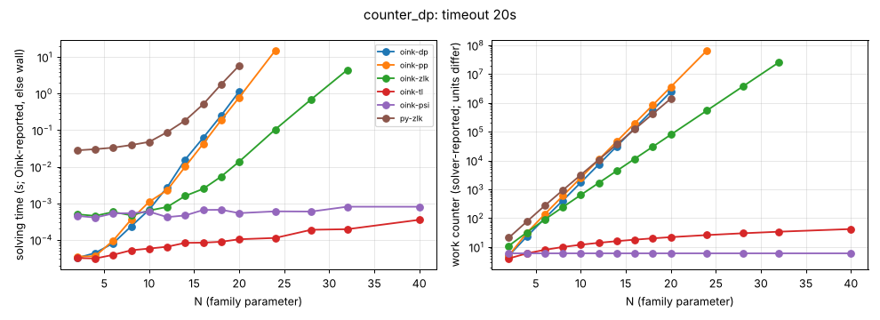

# counter_dp

**Verdict:** CONFIRMED. dp (the target) and pp grow by b = 2.07; zlk by 1.62; contrast tl (~linear) and psi (constant) up to N = 40. Re-run 2026-10-14 with positional-strategy checks (harness/verify.py): every finishing solver's strategies verified, no disagreement.

- Generator source: github.com/trolando/oink @ 8fbf0a7c3e5b0baa254cb4516258c5c42fa99db1, src/tools/counter_dp.cpp
- Command: `tools/oink/build/counter_dp N` (N = family parameter)
- What the source says: Oink README.md:191: 'Counterexample to the DP solver'
- Paper: none given (awaiting source)
- Targeted solvers: oink-dp, oink-pp; contrast: oink-tl, oink-psi, oink-zlk
- Agreement: every solver that finished on an instance gave the same winner on every vertex (py-zlk, the independent Python Zielonka, included while it finished). Run statuses: ok 72, skipped 8, timeout 4.
- Re-run: `experiments/hard-families/run_all.sh counter_dp` (Oink built by scripts/setup_oink.sh).

## Growth over the last finished sizes
b: fitted base of work ~ b^N; k: fitted exponent of work ~ n^k (n = vertices). An exponential family shows k rising with N and b > 1 stable; a polynomial one shows b -> 1.

| solver | sizes N | b (per +1 in N) | k (in n) | work at largest N |
|---|---|---|---|---|
| oink-pp | 16..24 | 2.066 | 15.12 | 65532657 promotions |
| oink-dp | 14..20 | 2.066 | 12.92 | 2434705 promotions |
| py-zlk | 14..20 | 1.839 | 10.85 | 1409972 iterations |
| oink-zlk | 20..32 | 1.618 | 12.74 | 25504082 iterations |
| oink-tl | 24..40 | 1.030 | 0.97 | 42 iterations |
| oink-psi | 24..40 | 1.000 | 0.00 | 6 major iterations |

## Sweep table

| N | n | m | d | oink-dp (promotions) | oink-pp (promotions) | oink-zlk (iterations) | oink-tl (iterations) | oink-psi (major iterations) | py-zlk (iterations) |
|---|---|---|---|---|---|---|---|---|---|
| 2 | 12 | 19 | 6 | 5 / 3.2e-05 | 5 / 3.5e-05 | 11 / 0.000501 | 4 / 3.2e-05 | 6 / 0.000455 | 21 / 0.0281 |
| 4 | 20 | 33 | 8 | 23 / 4.4e-05 | 31 / 3.6e-05 | 32 / 0.000454 | 6 / 3.1e-05 | 6 / 0.000407 | 76 / 0.0302 |
| 6 | 28 | 47 | 10 | 99 / 8.1e-05 | 138 / 9.6e-05 | 90 / 0.00058 | 8 / 3.9e-05 | 6 / 0.000529 | 273 / 0.0333 |
| 8 | 36 | 61 | 12 | 410 / 0.000236 | 595 / 0.000361 | 242 / 0.00047 | 10 / 5.2e-05 | 6 / 0.000536 | 936 / 0.0392 |
| 10 | 44 | 75 | 14 | 1730 / 0.000671 | 2541 / 0.0011 | 640 / 0.000634 | 12 / 5.8e-05 | 6 / 0.00059 | 3177 / 0.0478 |
| 12 | 52 | 89 | 16 | 7353 / 0.00276 | 10841 / 0.00229 | 1682 / 0.000796 | 14 / 6.5e-05 | 6 / 0.00042 | 10760 / 0.0883 |
| 14 | 60 | 103 | 18 | 31330 / 0.0157 | 46263 / 0.0101 | 4410 / 0.00159 | 16 / 8.3e-05 | 6 / 0.000466 | 36413 / 0.184 |
| 16 | 68 | 117 | 20 | 133664 / 0.062 | 197445 / 0.0427 | 11552 / 0.00249 | 18 / 8.4e-05 | 6 / 0.000658 | 123196 / 0.511 |
| 18 | 76 | 131 | 22 | 570435 / 0.253 | 842732 / 0.189 | 30250 / 0.00541 | 20 / 8.9e-05 | 6 / 0.000666 | 416781 / 1.79 |
| 20 | 84 | 145 | 24 | 2434705 / 1.15 | 3597020 / 0.789 | 79202 / 0.0138 | 22 / 0.000104 | 6 / 0.000539 | 1409972 / 5.87 |
| 24 | 100 | 173 | 28 | timeout | 65532657 / 15.1 | 542882 / 0.104 | 26 / 0.000113 | 6 / 0.000603 | timeout |
| 28 | 116 | 201 | 32 | skipped | timeout | 3720992 / 0.697 | 30 / 0.000189 | 6 / 0.000596 | skipped |
| 32 | 132 | 229 | 36 | skipped | skipped | 25504082 / 4.44 | 34 / 0.000196 | 6 / 0.000808 | skipped |
| 40 | 164 | 285 | 44 | skipped | skipped | timeout | 42 / 0.000354 | 6 / 0.000806 | skipped |

