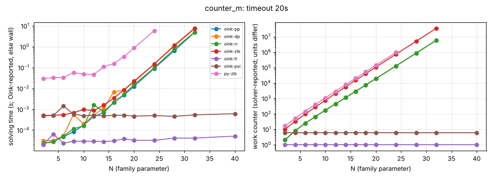

# counter_m

**Verdict:** CONFIRMED for the priority-promotion family as measured (pp, dp, rr: b = 1.61; zlk 1.62); the source names no target. Contrast tl and psi constant up to N = 40. Re-run 2026-10-14 with positional-strategy checks (harness/verify.py): every finishing solver's strategies verified, no disagreement.

- Generator source: github.com/trolando/oink @ 8fbf0a7c3e5b0baa254cb4516258c5c42fa99db1, src/tools/counter_m.cpp
- Command: `tools/oink/build/counter_m N` (N = family parameter)
- What the source says: Oink README.md:192: 'Counterexample of Maciej Gazda, PhD Thesis, Sec. 3.5' (the solver it targets is not named in the repository; measured: priority promotion family)
- Paper: M. Gazda, PhD thesis, Sec. 3.5 (awaiting source)
- Targeted solvers: oink-pp, oink-dp, oink-rr; contrast: oink-tl, oink-psi, oink-zlk
- Agreement: every solver that finished on an instance gave the same winner on every vertex (py-zlk, the independent Python Zielonka, included while it finished). Run statuses: ok 91, skipped 2, timeout 5.
- Re-run: `experiments/hard-families/run_all.sh counter_m` (Oink built by scripts/setup_oink.sh).

## Growth over the last finished sizes
b: fitted base of work ~ b^N; k: fitted exponent of work ~ n^k (n = vertices). An exponential family shows k rising with N and b > 1 stable; a polynomial one shows b -> 1.

| solver | sizes N | b (per +1 in N) | k (in n) | work at largest N |
|---|---|---|---|---|
| oink-zlk | 20..32 | 1.622 | 12.81 | 34469406 iterations |
| py-zlk | 16..24 | 1.621 | 10.07 | 956182 iterations |
| oink-pp | 20..32 | 1.612 | 12.64 | 5768405 promotions |
| oink-dp | 20..32 | 1.612 | 12.64 | 5768405 promotions |
| oink-rr | 20..32 | 1.612 | 12.64 | 5768405 promotions |
| oink-tl | 24..40 | 1.000 | 0.00 | 1 iterations |
| oink-psi | 24..40 | 1.000 | 0.00 | 6 major iterations |

## Sweep table

| N | n | m | d | oink-pp (promotions) | oink-dp (promotions) | oink-rr (promotions) | oink-zlk (iterations) | oink-tl (iterations) | oink-psi (major iterations) | py-zlk (iterations) |
|---|---|---|---|---|---|---|---|---|---|---|
| 2 | 9 | 15 | 5 | 2 / 2.2e-05 | 2 / 3e-05 | 2 / 2.3e-05 | 10 / 0.000506 | 1 / 2e-05 | 6 / 0.000482 | 16 / 0.029 |
| 4 | 15 | 27 | 7 | 8 / 2.9e-05 | 8 / 3.1e-05 | 8 / 2.7e-05 | 32 / 0.000508 | 1 / 6.3e-05 | 6 / 0.000499 | 51 / 0.0321 |
| 6 | 21 | 39 | 9 | 24 / 4.7e-05 | 24 / 5.3e-05 | 24 / 5.1e-05 | 95 / 0.000534 | 1 / 2.3e-05 | 6 / 0.0014 | 146 / 0.0332 |
| 8 | 27 | 51 | 11 | 65 / 8.3e-05 | 65 / 0.000551 | 65 / 0.000115 | 270 / 0.00068 | 1 / 2.9e-05 | 6 / 0.000578 | 400 / 0.0561 |
| 10 | 33 | 63 | 13 | 169 / 0.000168 | 169 / 0.000197 | 169 / 0.000157 | 748 / 0.00096 | 1 / 2.9e-05 | 6 / 0.000489 | 1075 / 0.0485 |
| 12 | 39 | 75 | 15 | 433 / 0.00045 | 433 / 0.000513 | 433 / 0.00161 | 2039 / 0.000851 | 1 / 2.9e-05 | 6 / 0.000512 | 2862 / 0.0456 |
| 14 | 45 | 87 | 17 | 1106 / 0.000684 | 1106 / 0.00109 | 1106 / 0.00076 | 5498 / 0.00156 | 1 / 2.8e-05 | 6 / 0.000476 | 7580 / 0.108 |
| 16 | 51 | 99 | 19 | 2830 / 0.00211 | 2830 / 0.00683 | 2830 / 0.00216 | 14712 / 0.0034 | 1 / 3e-05 | 6 / 0.000506 | 20011 / 0.154 |
| 18 | 57 | 111 | 21 | 7266 / 0.00467 | 7266 / 0.00817 | 7266 / 0.00505 | 39151 / 0.00843 | 1 / 3.8e-05 | 6 / 0.000518 | 52714 / 0.332 |
| 20 | 63 | 123 | 23 | 18723 / 0.0124 | 18723 / 0.0202 | 18723 / 0.0149 | 103766 / 0.0221 | 1 / 3.2e-05 | 6 / 0.000463 | 138648 / 0.871 |
| 24 | 75 | 147 | 27 | 125475 / 0.0903 | 125475 / 0.145 | 125475 / 0.096 | 722919 / 0.145 | 1 / 3.2e-05 | 6 / 0.000494 | 956182 / 5.75 |
| 28 | 87 | 171 | 31 | 848408 / 0.633 | 848408 / 1.06 | 848408 / 0.776 | 5001728 / 1.15 | 1 / 4.1e-05 | 6 / 0.000452 | timeout |
| 32 | 99 | 195 | 35 | 5768405 / 4.84 | 5768405 / 7.24 | 5768405 / 4.95 | 34469406 / 7.58 | 1 / 4.1e-05 | 6 / 0.000533 | skipped |
| 40 | 123 | 243 | 43 | timeout | timeout | timeout | timeout | 1 / 5.1e-05 | 6 / 0.000605 | skipped |

