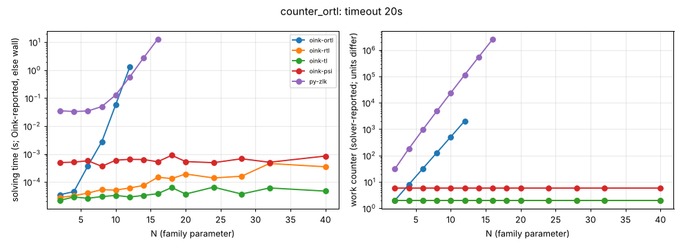

# counter_ortl

**Verdict:** CONFIRMED. ortl (the target) grows by b = 2.00 (2048 iterations at N = 12, then timeout); contrast rtl, tl (2 iterations) and psi (6) constant up to N = 40. Re-run 2026-10-14 with positional-strategy checks (harness/verify.py): every finishing solver's strategies verified, no disagreement.

- Generator source: github.com/trolando/oink @ 8fbf0a7c3e5b0baa254cb4516258c5c42fa99db1, src/tools/counter_ortl.cpp
- Command: `tools/oink/build/counter_ortl N` (N = family parameter)
- What the source says: Oink README.md:197: 'Counterexample to the ORTL solver'
- Paper: none given (awaiting source)
- Targeted solvers: oink-ortl; contrast: oink-rtl, oink-tl, oink-psi
- Agreement: every solver that finished on an instance gave the same winner on every vertex (py-zlk, the independent Python Zielonka, included while it finished). Run statuses: ok 56, skipped 12, timeout 2.
- Re-run: `experiments/hard-families/run_all.sh counter_ortl` (Oink built by scripts/setup_oink.sh).

## Growth over the last finished sizes
b: fitted base of work ~ b^N; k: fitted exponent of work ~ n^k (n = vertices). An exponential family shows k rising with N and b > 1 stable; a polynomial one shows b -> 1.

| solver | sizes N | b (per +1 in N) | k (in n) | work at largest N |
|---|---|---|---|---|
| py-zlk | 10..16 | 2.184 | 10.10 | 2580476 iterations |
| oink-ortl | 6..12 | 2.000 | 6.10 | 2048 iterations |
| oink-rtl | 24..40 | 1.000 | 0.00 | 2 iterations |
| oink-tl | 24..40 | 1.000 | 0.00 | 2 iterations |
| oink-psi | 24..40 | 1.000 | 0.00 | 6 major iterations |

## Sweep table

| N | n | m | d | oink-ortl (iterations) | oink-rtl (iterations) | oink-tl (iterations) | oink-psi (major iterations) | py-zlk (iterations) |
|---|---|---|---|---|---|---|---|---|
| 2 | 11 | 17 | 8 | 2 / 3.5e-05 | 2 / 2.8e-05 | 2 / 2.2e-05 | 6 / 0.000493 | 31 / 0.0351 |
| 4 | 21 | 33 | 14 | 8 / 4.5e-05 | 2 / 3.2e-05 | 2 / 2.9e-05 | 6 / 0.000511 | 182 / 0.033 |
| 6 | 31 | 49 | 20 | 32 / 0.000372 | 2 / 4e-05 | 2 / 2.6e-05 | 6 / 0.000572 | 956 / 0.0345 |
| 8 | 41 | 65 | 26 | 128 / 0.00276 | 2 / 5.3e-05 | 2 / 3e-05 | 6 / 0.000362 | 4828 / 0.0497 |
| 10 | 51 | 81 | 32 | 512 / 0.0589 | 2 / 5.1e-05 | 2 / 3.3e-05 | 6 / 0.0006 | 23804 / 0.13 |
| 12 | 61 | 97 | 38 | 2048 / 1.29 | 2 / 6.1e-05 | 2 / 2.9e-05 | 6 / 0.000644 | 115196 / 0.57 |
| 14 | 71 | 113 | 44 | timeout | 2 / 7.5e-05 | 2 / 3.3e-05 | 6 / 0.000632 | 548860 / 2.8 |
| 16 | 81 | 129 | 50 | skipped | 2 / 0.000147 | 2 / 3.8e-05 | 6 / 0.000529 | 2580476 / 12.8 |
| 18 | 91 | 145 | 56 | skipped | 2 / 0.000132 | 2 / 6.3e-05 | 6 / 0.000897 | timeout |
| 20 | 101 | 161 | 62 | skipped | 2 / 0.000192 | 2 / 3.7e-05 | 6 / 0.000535 | skipped |
| 24 | 121 | 193 | 74 | skipped | 2 / 0.000139 | 2 / 6.5e-05 | 6 / 0.000489 | skipped |
| 28 | 141 | 225 | 86 | skipped | 2 / 0.00016 | 2 / 3.7e-05 | 6 / 0.000675 | skipped |
| 32 | 161 | 257 | 98 | skipped | 2 / 0.000456 | 2 / 6.1e-05 | 6 / 0.000506 | skipped |
| 40 | 201 | 321 | 122 | skipped | 2 / 0.000349 | 2 / 4.7e-05 | 6 / 0.000844 | skipped |

