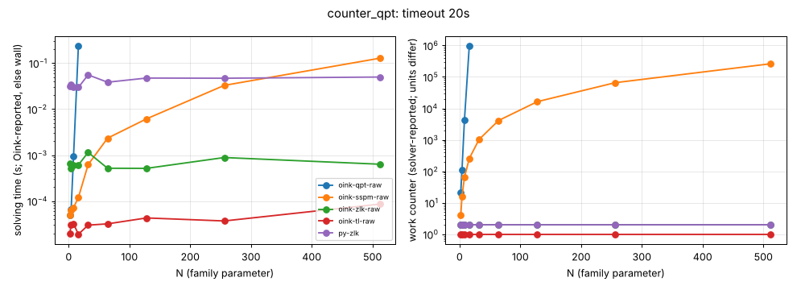

# counter_qpt

**Verdict:** BLOW-UP OBSERVED, TYPE OPEN. With preprocessing off, qpt's lifts grow fast (work ~ n^5.2 between N = 2 and 16, 975553 lifts at N = 16; timeout at N = 32), sizes were doubled so the growth type (polynomial of high degree vs super-polynomial) is not determined; needs N = 16..32 step 1. Contrast zlk, tl constant; sspm ~ n^2. Oink with default preprocessing solves the family outright. Positional strategies were not checked in this sweep (the check was added to sweep.py during it); a re-run with strategy checks is pending.

- Generator source: github.com/trolando/oink @ 8fbf0a7c3e5b0baa254cb4516258c5c42fa99db1, src/tools/counter_qpt.cpp
- Command: `tools/oink/build/counter_qpt N` (N = family parameter)
- What the source says: Oink README.md:193: 'Counterexample of Fearnley et al, An ordered approach to solving parity games in quasi polynomial time and quasi linear space'
- Paper: Fearnley, Jain, Schewe, Stephan, Wojtczak, SPIN 2017, doi:10.1145/3092282.3092286 (awaiting source)
- Targeted solvers: oink-qpt-raw, oink-sspm-raw; contrast: oink-zlk-raw, oink-tl-raw
- Agreement: every solver that finished on an instance gave the same winner on every vertex (py-zlk, the independent Python Zielonka, included while it finished). Run statuses: ok 40, skipped 4, timeout 1.
- Re-run: `experiments/hard-families/run_all.sh counter_qpt` (Oink built by scripts/setup_oink.sh).

## Growth over the last finished sizes
b: fitted base of work ~ b^N; k: fitted exponent of work ~ n^k (n = vertices). An exponential family shows k rising with N and b > 1 stable; a polynomial one shows b -> 1.

| solver | sizes N | b (per +1 in N) | k (in n) | work at largest N |
|---|---|---|---|---|
| oink-qpt-raw | 2..16 | 2.151 | 5.17 | 975553 lifts |
| oink-sspm-raw | 64..512 | 1.009 | 2.00 | 262144 lifts |
| oink-zlk-raw | 64..512 | 1.000 | 0.00 | 2 iterations |
| oink-tl-raw | 64..512 | 1.000 | 0.00 | 1 iterations |
| py-zlk | 64..512 | 1.000 | 0.00 | 2 iterations |

## Sweep table

| N | n | m | d | oink-qpt-raw (lifts) | oink-sspm-raw (lifts) | oink-zlk-raw (iterations) | oink-tl-raw (iterations) | py-zlk (iterations) |
|---|---|---|---|---|---|---|---|---|
| 2 | 4 | 5 | 4 | 21 / 5e-05 | 4 / 5e-05 | 2 / 0.000654 | 1 / 2e-05 | 2 / 0.0319 |
| 4 | 8 | 11 | 8 | 113 / 6.5e-05 | 16 / 6.3e-05 | 2 / 0.000522 | 1 / 3e-05 | 2 / 0.0342 |
| 8 | 16 | 23 | 16 | 4187 / 0.00094 | 64 / 7.2e-05 | 2 / 0.000606 | 1 / 3.2e-05 | 2 / 0.0303 |
| 16 | 32 | 47 | 32 | 975553 / 0.238 | 256 / 0.00012 | 2 / 0.000612 | 1 / 1.9e-05 | 2 / 0.0297 |
| 32 | 64 | 95 | 64 | timeout | 1024 / 0.00062 | 2 / 0.00115 | 1 / 3e-05 | 2 / 0.0556 |
| 64 | 128 | 191 | 128 | skipped | 4096 / 0.00234 | 2 / 0.000518 | 1 / 3.2e-05 | 2 / 0.0385 |
| 128 | 256 | 383 | 256 | skipped | 16384 / 0.00613 | 2 / 0.000515 | 1 / 4.3e-05 | 2 / 0.0474 |
| 256 | 512 | 767 | 512 | skipped | 65536 / 0.0328 | 2 / 0.000886 | 1 / 3.7e-05 | 2 / 0.047 |
| 512 | 1024 | 1535 | 1024 | skipped | 262144 / 0.128 | 2 / 0.000634 | 1 / 8.6e-05 | 2 / 0.0499 |

