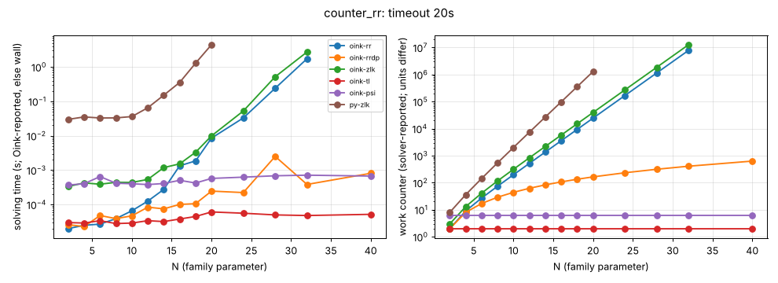

# counter_rr

**Verdict:** CONFIRMED. rr (the target) grows by b = 1.618 (Fibonacci-like), as does zlk; rrdp grows slowly (b = 1.06); contrast tl and psi are constant (2 and 6) up to N = 40. Re-run 2026-10-14 with positional-strategy checks (harness/verify.py): every finishing solver's strategies verified, no disagreement.

- Generator source: github.com/trolando/oink @ 8fbf0a7c3e5b0baa254cb4516258c5c42fa99db1, src/tools/counter_rr.cpp
- Command: `tools/oink/build/counter_rr N` (N = family parameter)
- What the source says: Oink README.md:190: 'Counterexample to the RR solver'
- Paper: none given (awaiting source)
- Targeted solvers: oink-rr, oink-rrdp; contrast: oink-tl, oink-psi, oink-zlk
- Agreement: every solver that finished on an instance gave the same winner on every vertex (py-zlk, the independent Python Zielonka, included while it finished). Run statuses: ok 78, skipped 3, timeout 3.
- Re-run: `experiments/hard-families/run_all.sh counter_rr` (Oink built by scripts/setup_oink.sh).

## Growth over the last finished sizes
b: fitted base of work ~ b^N; k: fitted exponent of work ~ n^k (n = vertices). An exponential family shows k rising with N and b > 1 stable; a polynomial one shows b -> 1.

| solver | sizes N | b (per +1 in N) | k (in n) | work at largest N |
|---|---|---|---|---|
| py-zlk | 14..20 | 1.907 | 10.84 | 1294985 iterations |
| oink-zlk | 20..32 | 1.618 | 12.25 | 12752024 iterations |
| oink-rr | 20..32 | 1.618 | 12.25 | 7881194 promotions |
| oink-rrdp | 24..40 | 1.063 | 1.94 | 629 promotions |
| oink-tl | 24..40 | 1.000 | 0.00 | 2 iterations |
| oink-psi | 24..40 | 1.000 | 0.00 | 6 major iterations |

## Sweep table

| N | n | m | d | oink-rr (promotions) | oink-rrdp (promotions) | oink-zlk (iterations) | oink-tl (iterations) | oink-psi (major iterations) | py-zlk (iterations) |
|---|---|---|---|---|---|---|---|---|---|
| 2 | 8 | 16 | 4 | 2 / 2e-05 | 2 / 2.6e-05 | 3 / 0.000335 | 2 / 3e-05 | 6 / 0.000369 | 8 / 0.0299 |
| 4 | 16 | 32 | 8 | 9 / 2.5e-05 | 8 / 2.3e-05 | 13 / 0.000426 | 2 / 2.9e-05 | 6 / 0.000403 | 36 / 0.0352 |
| 6 | 24 | 48 | 12 | 27 / 2.7e-05 | 17 / 4.8e-05 | 41 / 0.00039 | 2 / 3.4e-05 | 6 / 0.000651 | 143 / 0.0328 |
| 8 | 32 | 64 | 16 | 74 / 3.9e-05 | 29 / 3.9e-05 | 116 / 0.000443 | 2 / 2.8e-05 | 6 / 0.000416 | 542 / 0.033 |
| 10 | 40 | 80 | 20 | 197 / 6.6e-05 | 44 / 4.7e-05 | 314 / 0.000439 | 2 / 2.9e-05 | 6 / 0.000403 | 2010 / 0.0361 |
| 12 | 48 | 96 | 24 | 519 / 0.000126 | 62 / 8.4e-05 | 834 / 0.000538 | 2 / 3.4e-05 | 6 / 0.000381 | 7376 / 0.0651 |
| 14 | 56 | 112 | 28 | 1362 / 0.000276 | 83 / 7.5e-05 | 2197 / 0.00119 | 2 / 3.2e-05 | 6 / 0.000409 | 26927 / 0.15 |
| 16 | 64 | 128 | 32 | 3569 / 0.00134 | 107 / 0.000101 | 5767 / 0.00152 | 2 / 3.8e-05 | 6 / 0.000506 | 98039 / 0.354 |
| 18 | 72 | 144 | 36 | 9347 / 0.00186 | 134 / 0.000106 | 15115 / 0.00331 | 2 / 4.5e-05 | 6 / 0.000423 | 356449 / 1.29 |
| 20 | 80 | 160 | 40 | 24474 / 0.00854 | 164 / 0.000246 | 39590 / 0.00989 | 2 / 6.1e-05 | 6 / 0.000575 | 1294985 / 4.42 |
| 24 | 96 | 192 | 48 | 167759 / 0.0329 | 233 / 0.000223 | 271428 / 0.0524 | 2 / 5.6e-05 | 6 / 0.000626 | timeout |
| 28 | 112 | 224 | 56 | 1149849 / 0.24 | 314 / 0.00251 | 1860481 / 0.517 | 2 / 5e-05 | 6 / 0.000686 | skipped |
| 32 | 128 | 256 | 64 | 7881194 / 1.73 | 407 / 0.000384 | 12752024 / 2.71 | 2 / 4.8e-05 | 6 / 0.000714 | skipped |
| 40 | 160 | 320 | 80 | timeout | 629 / 0.000809 | timeout | 2 / 5.2e-05 | 6 / 0.000673 | skipped |

