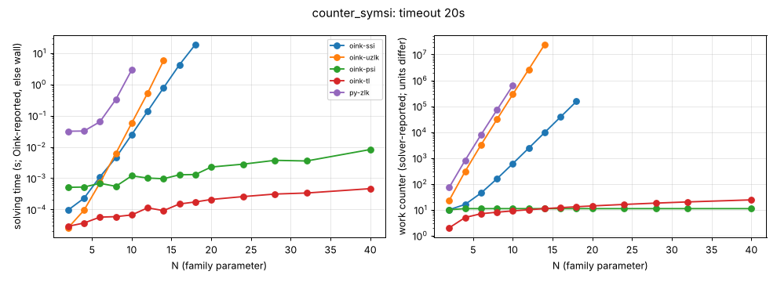

# counter_symsi

**Verdict:** CONFIRMED. ssi (the target) grows by b = 2.00 per +1 in N (152924 major iterations at N = 18, timeout after); uzlk also blows up (3.04). Contrast psi is constant (11 major iterations) and tl ~ linear up to N = 40. Positional strategies were not checked in this sweep (the check was added to sweep.py during it); a re-run with strategy checks is pending.

- Generator source: github.com/trolando/oink @ 8fbf0a7c3e5b0baa254cb4516258c5c42fa99db1, src/tools/counter_symsi.cpp
- Command: `tools/oink/build/counter_symsi N` (N = family parameter)
- What the source says: Oink README.md:198 and counter_symsi.cpp:23: 'Matthew Maat's counterexample to Schewe et al's symmetric strategy improvement'
- Paper: M. Maat (no reference in the repository); Schewe et al. symmetric strategy improvement (awaiting source)
- Targeted solvers: oink-ssi; contrast: oink-psi, oink-tl, oink-uzlk
- Agreement: every solver that finished on an instance gave the same winner on every vertex (py-zlk, the independent Python Zielonka, included while it finished). Run statuses: ok 49, skipped 18, timeout 3.
- Re-run: `experiments/hard-families/run_all.sh counter_symsi` (Oink built by scripts/setup_oink.sh).

## Growth over the last finished sizes
b: fitted base of work ~ b^N; k: fitted exponent of work ~ n^k (n = vertices). An exponential family shows k rising with N and b > 1 stable; a polynomial one shows b -> 1.

| solver | sizes N | b (per +1 in N) | k (in n) | work at largest N |
|---|---|---|---|---|
| oink-uzlk | 8..14 | 3.035 | 12.08 | 24112760 iterations |
| py-zlk | 4..10 | 3.033 | 7.43 | 633687 iterations |
| oink-ssi | 12..18 | 1.999 | 10.37 | 152924 major iterations |
| oink-tl | 24..40 | 1.025 | 0.80 | 24 iterations |
| oink-psi | 24..40 | 1.000 | 0.00 | 11 major iterations |

## Sweep table

| N | n | m | d | oink-ssi (major iterations) | oink-uzlk (iterations) | oink-psi (major iterations) | oink-tl (iterations) | py-zlk (iterations) |
|---|---|---|---|---|---|---|---|---|
| 2 | 22 | 48 | 21 | 10 / 9.6e-05 | 23 / 2.6e-05 | 10 / 0.00051 | 2 / 2.9e-05 | 73 / 0.0316 |
| 4 | 42 | 92 | 41 | 16 / 0.000229 | 302 / 9.5e-05 | 11 / 0.000521 | 5 / 3.7e-05 | 810 / 0.0321 |
| 6 | 62 | 136 | 61 | 44 / 0.0011 | 3206 / 0.000707 | 11 / 0.000685 | 7 / 5.7e-05 | 7883 / 0.0636 |
| 8 | 82 | 180 | 81 | 156 / 0.00451 | 30853 / 0.00619 | 11 / 0.00055 | 8 / 5.9e-05 | 71357 / 0.328 |
| 10 | 102 | 224 | 101 | 604 / 0.0247 | 287294 / 0.0578 | 11 / 0.00119 | 9 / 6.7e-05 | 633687 / 2.89 |
| 12 | 122 | 268 | 121 | 2396 / 0.138 | 2641546 / 0.524 | 11 / 0.00101 | 10 / 0.000113 | timeout |
| 14 | 142 | 312 | 141 | 9564 / 0.772 | 24112760 / 5.68 | 11 / 0.000961 | 11 / 9.2e-05 | skipped |
| 16 | 162 | 356 | 161 | 38236 / 4.19 | timeout | 11 / 0.00128 | 12 / 0.00015 | skipped |
| 18 | 182 | 400 | 181 | 152924 / 18.6 | skipped | 11 / 0.00131 | 13 / 0.000174 | skipped |
| 20 | 202 | 444 | 201 | timeout | skipped | 11 / 0.00227 | 14 / 0.000209 | skipped |
| 24 | 242 | 532 | 241 | skipped | skipped | 11 / 0.0028 | 16 / 0.000258 | skipped |
| 28 | 282 | 620 | 281 | skipped | skipped | 11 / 0.00372 | 18 / 0.000311 | skipped |
| 32 | 322 | 708 | 321 | skipped | skipped | 11 / 0.00355 | 20 / 0.000336 | skipped |
| 40 | 402 | 884 | 401 | skipped | skipped | 11 / 0.00823 | 24 / 0.000463 | skipped |

