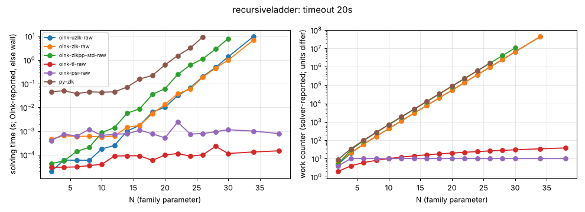

# recursiveladder

**Verdict:** CONFIRMED (on the Python port). Zielonka grows by b = 1.618 per +1 in N in Oink uzlk/zlk/zlkpp-std and in the independent py-zlk (44.8M iterations at N = 34); contrast tl (~linear) and psi (constant) up to N = 38. Positional strategies were not checked in this sweep (the check was added to sweep.py during it); a re-run with strategy checks is pending.

- Generator source: github.com/tcsprojects/pgsolver @ d3cd624b61cd66739c45aff9554f6bbdcdd05401, src/lib/generators/recursiveladder.ml (Python port: pgsolver_port.py)
- Command: `python3 experiments/hard-families/pgsolver_port.py recursiveladder N` (N = family parameter)
- What the source says: PGSolver registers it as 'Recursive Ladder Game' (recursiveladder.ml:48); the repository does not state the target; it is cited in the literature as Friedmann's lower bound for the recursive (Zielonka) algorithm (Lead brief; awaiting source)
- Paper: O. Friedmann, recursive algorithm lower bound (awaiting source)
- Targeted solvers: oink-uzlk-raw, oink-zlk-raw, oink-zlkpp-std-raw; contrast: oink-tl-raw, oink-psi-raw
- Agreement: every solver that finished on an instance gave the same winner on every vertex (py-zlk, the independent Python Zielonka, included while it finished). Run statuses: ok 94, skipped 4, timeout 4.
- Re-run: `experiments/hard-families/run_all.sh recursiveladder` (Oink built by scripts/setup_oink.sh).

## Growth over the last finished sizes
b: fitted base of work ~ b^N; k: fitted exponent of work ~ n^k (n = vertices). An exponential family shows k rising with N and b > 1 stable; a polynomial one shows b -> 1.

| solver | sizes N | b (per +1 in N) | k (in n) | work at largest N |
|---|---|---|---|---|
| py-zlk | 20..26 | 1.618 | 10.99 | 1589049 iterations |
| oink-zlkpp-std-raw | 24..30 | 1.618 | 12.93 | 10695118 iterations |
| oink-uzlk-raw | 26..34 | 1.618 | 14.40 | 44791052 iterations |
| oink-zlk-raw | 26..34 | 1.618 | 14.40 | 44791053 iterations |
| oink-tl-raw | 28..38 | 1.031 | 1.00 | 38 iterations |
| oink-psi-raw | 28..38 | 1.000 | 0.00 | 10 major iterations |

## Sweep table

| N | n | m | d | oink-uzlk-raw (iterations) | oink-zlk-raw (iterations) | oink-zlkpp-std-raw (iterations) | oink-tl-raw (iterations) | oink-psi-raw (major iterations) | py-zlk (iterations) |
|---|---|---|---|---|---|---|---|---|---|
| 2 | 10 | 19 | 8 | 5 / 2e-05 | 6 / 0.00046 | 5 / 4.3e-05 | 2 / 3e-05 | 4 / 0.000401 | 9 / 0.0463 |
| 4 | 20 | 41 | 14 | 20 / 6e-05 | 21 / 0.000639 | 30 / 5.5e-05 | 4 / 3e-05 | 10 / 0.000747 | 34 / 0.0503 |
| 6 | 30 | 63 | 20 | 59 / 5.9e-05 | 60 / 0.000601 | 94 / 0.000139 | 6 / 3.1e-05 | 10 / 0.00062 | 99 / 0.0384 |
| 8 | 40 | 85 | 26 | 161 / 5.9e-05 | 162 / 0.000606 | 261 / 0.000206 | 8 / 3.5e-05 | 10 / 0.00118 | 269 / 0.045 |
| 10 | 50 | 107 | 32 | 428 / 0.000179 | 429 / 0.000561 | 698 / 0.000866 | 10 / 4e-05 | 10 / 0.000652 | 714 / 0.0438 |
| 12 | 60 | 129 | 38 | 1127 / 0.000248 | 1128 / 0.000628 | 1842 / 0.00141 | 12 / 8.9e-05 | 10 / 0.000742 | 1879 / 0.0452 |
| 14 | 70 | 151 | 44 | 2957 / 0.00101 | 2958 / 0.00145 | 4837 / 0.0057 | 14 / 9.1e-05 | 10 / 0.000772 | 4929 / 0.0722 |
| 16 | 80 | 173 | 50 | 7748 / 0.00176 | 7749 / 0.00173 | 12678 / 0.00878 | 16 / 9.1e-05 | 10 / 0.00109 | 12914 / 0.157 |
| 18 | 90 | 195 | 56 | 20291 / 0.00638 | 20292 / 0.0055 | 33206 / 0.0354 | 18 / 5.8e-05 | 10 / 0.000771 | 33819 / 0.224 |
| 20 | 100 | 217 | 62 | 53129 / 0.0102 | 53130 / 0.0134 | 86949 / 0.0618 | 20 / 9.8e-05 | 10 / 0.000515 | 88549 / 0.619 |
| 22 | 110 | 239 | 68 | 139100 / 0.0313 | 139101 / 0.0374 | 227650 / 0.245 | 22 / 0.000114 | 10 / 0.0024 | 231834 / 1.52 |
| 24 | 120 | 261 | 74 | 364175 / 0.0666 | 364176 / 0.0606 | 596010 / 0.611 | 24 / 8.7e-05 | 10 / 0.000752 | 606959 / 3.21 |
| 26 | 130 | 283 | 80 | 953429 / 0.202 | 953430 / 0.191 | 1560389 / 1.13 | 26 / 0.000101 | 10 / 0.000791 | 1589049 / 9.44 |
| 28 | 140 | 305 | 86 | 2496116 / 0.485 | 2496117 / 0.45 | 4085166 / 2.86 | 28 / 0.000228 | 10 / 0.000948 | timeout |
| 30 | 150 | 327 | 92 | 6534923 / 1.36 | 6534924 / 0.988 | 10695118 / 7.92 | 30 / 0.000114 | 10 / 0.00114 | skipped |
| 34 | 170 | 371 | 104 | 44791052 / 9.75 | 44791053 / 6.88 | timeout | 34 / 0.000132 | 10 / 0.001 | skipped |
| 38 | 190 | 415 | 116 | timeout | timeout | skipped | 38 / 0.000147 | 10 / 0.000787 | skipped |

