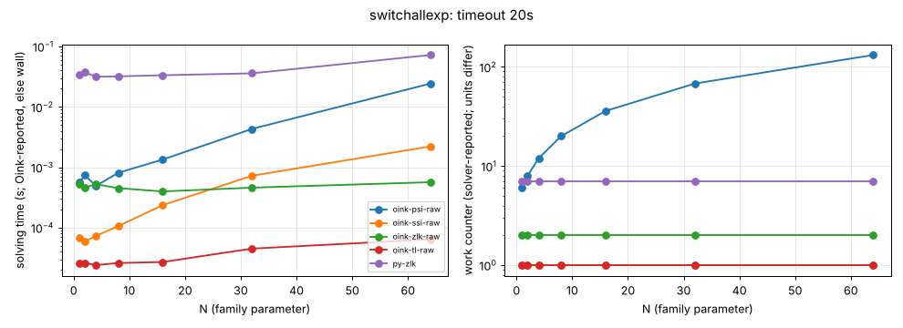

# switchallexp

**Verdict:** NOT CONFIRMED: the targeted algorithm (PGSolver's switch-all strategy improvement) was not run (PGSolver binaries blocked; port of stratimpralgs.ml queued). Oink's psi grows ~linearly (132 major iterations at N = 64) and ssi, zlk, tl are constant: the family does not hurt them. Positional strategies were not checked in this sweep (the check was added to sweep.py during it); a re-run with strategy checks is pending.

- Generator source: github.com/tcsprojects/pgsolver @ d3cd624b61cd66739c45aff9554f6bbdcdd05401, src/lib/generators/policyiter/generators/switchallexp.ml (Python port)
- Command: `python3 experiments/hard-families/pgsolver_port.py switchallexp N` (N = family parameter)
- What the source says: switchallexp.ml:72: 'Exponential Lower Bound for (Voege's) switch-all rule' (PGSolver's strategy improvement, src/lib/solvers/stratimpralgs.ml; not Oink's psi/ssi)
- Paper: O. Friedmann, strategy-improvement lower bounds (awaiting source)
- Targeted solvers: PGSolver switchall SI (not run, see README); contrast: oink-psi-raw, oink-ssi-raw, oink-zlk-raw, oink-tl-raw
- Agreement: every solver that finished on an instance gave the same winner on every vertex (py-zlk, the independent Python Zielonka, included while it finished). Run statuses: ok 35.
- Re-run: `experiments/hard-families/run_all.sh switchallexp` (Oink built by scripts/setup_oink.sh).

## Growth over the last finished sizes
b: fitted base of work ~ b^N; k: fitted exponent of work ~ n^k (n = vertices). An exponential family shows k rising with N and b > 1 stable; a polynomial one shows b -> 1.

| solver | sizes N | b (per +1 in N) | k (in n) | work at largest N |
|---|---|---|---|---|
| oink-psi-raw | 8..64 | 1.032 | 0.93 | 132 major iterations |
| oink-ssi-raw | 8..64 | 1.000 | 0.00 | 1 major iterations |
| oink-zlk-raw | 8..64 | 1.000 | 0.00 | 2 iterations |
| oink-tl-raw | 8..64 | 1.000 | 0.00 | 1 iterations |
| py-zlk | 8..64 | 1.000 | 0.00 | 7 iterations |

## Sweep table

| N | n | m | d | oink-psi-raw (major iterations) | oink-ssi-raw (major iterations) | oink-zlk-raw (iterations) | oink-tl-raw (iterations) | py-zlk (iterations) |
|---|---|---|---|---|---|---|---|---|
| 1 | 21 | 41 | 21 | 6 / 0.00056 | 1 / 6.7e-05 | 2 / 0.000534 | 1 / 2.6e-05 | 7 / 0.0345 |
| 2 | 35 | 75 | 35 | 8 / 0.000735 | 1 / 5.9e-05 | 2 / 0.000462 | 1 / 2.6e-05 | 7 / 0.0375 |
| 4 | 63 | 143 | 63 | 12 / 0.000492 | 1 / 7.3e-05 | 2 / 0.000524 | 1 / 2.4e-05 | 7 / 0.0315 |
| 8 | 119 | 279 | 119 | 20 / 0.00081 | 1 / 0.000106 | 2 / 0.000451 | 1 / 2.6e-05 | 7 / 0.032 |
| 16 | 231 | 551 | 231 | 36 / 0.00134 | 1 / 0.000236 | 2 / 0.000398 | 1 / 2.7e-05 | 7 / 0.0334 |
| 32 | 455 | 1095 | 455 | 68 / 0.00431 | 1 / 0.000723 | 2 / 0.00046 | 1 / 4.5e-05 | 7 / 0.0359 |
| 64 | 903 | 2183 | 903 | 132 / 0.0243 | 1 / 0.00221 | 2 / 0.000566 | 1 / 6.4e-05 | 7 / 0.0722 |

