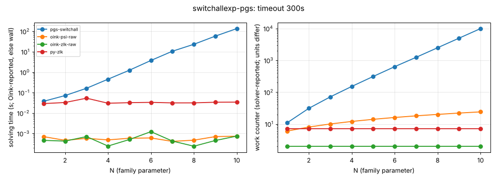

# switchallexp

**Verdict:** CONFIRMED against the targeted algorithm, run through Python ports: PGSolver's switch-all strategy improvement (pgsolver_si.py, port of stratimpralgs.ml; bare SI loop, without PGSolver's universal_solve preprocessing) takes 11, 31, 71, 151, 311, 631, 1244, 2487, 4973, 9928 iterations for N = 1..10 (doubling per N; table switchallexp-pgs below). Oink's psi grows ~linearly (24 major iterations at N = 10, 132 at N = 64), ssi, zlk, tl are constant: the family does not hurt them. Re-run 2026-10-14 with positional-strategy checks (harness/verify.py): every finishing solver's strategies verified, no disagreement.

- Generator source: github.com/tcsprojects/pgsolver @ d3cd624b61cd66739c45aff9554f6bbdcdd05401, src/lib/generators/policyiter/generators/switchallexp.ml (Python port)
- Command: `python3 experiments/hard-families/pgsolver_port.py switchallexp N` (N = family parameter)
- What the source says: switchallexp.ml:72: 'Exponential Lower Bound for (Voege's) switch-all rule' (PGSolver's strategy improvement, src/lib/solvers/stratimpralgs.ml; not Oink's psi/ssi)
- Paper: O. Friedmann, strategy-improvement lower bounds (awaiting source)
- Targeted solvers: PGSolver switchall SI (not run, see README); contrast: oink-psi-raw, oink-ssi-raw, oink-zlk-raw, oink-tl-raw
- Agreement: every solver that finished on an instance gave the same winner on every vertex (py-zlk, the independent Python Zielonka, included while it finished). Run statuses: ok 35.
- Re-run: `experiments/hard-families/run_all.sh switchallexp` (Oink built by scripts/setup_oink.sh).

## Growth over the last finished sizes
b: fitted base of work ~ b^N; k: fitted exponent of work ~ n^k (n = vertices). An exponential family shows k rising with N and b > 1 stable; a polynomial one shows b -> 1.

| solver | sizes N | b (per +1 in N) | k (in n) | work at largest N |
|---|---|---|---|---|
| oink-psi-raw | 8..64 | 1.032 | 0.93 | 132 major iterations |
| oink-ssi-raw | 8..64 | 1.000 | 0.00 | 1 major iterations |
| oink-zlk-raw | 8..64 | 1.000 | 0.00 | 2 iterations |
| oink-tl-raw | 8..64 | 1.000 | 0.00 | 1 iterations |
| py-zlk | 8..64 | 1.000 | 0.00 | 7 iterations |

## Sweep table

| N | n | m | d | oink-psi-raw (major iterations) | oink-ssi-raw (major iterations) | oink-zlk-raw (iterations) | oink-tl-raw (iterations) | py-zlk (iterations) |
|---|---|---|---|---|---|---|---|---|
| 1 | 21 | 41 | 21 | 6 / 0.000691 | 1 / 5e-05 | 2 / 0.000611 | 1 / 3.5e-05 | 7 / 0.0314 |
| 2 | 35 | 75 | 35 | 8 / 0.000515 | 1 / 6.2e-05 | 2 / 0.000777 | 1 / 2.6e-05 | 7 / 0.0312 |
| 4 | 63 | 143 | 63 | 12 / 0.000547 | 1 / 6.6e-05 | 2 / 0.00298 | 1 / 3.3e-05 | 7 / 0.0364 |
| 8 | 119 | 279 | 119 | 20 / 0.00114 | 1 / 0.000123 | 2 / 0.000634 | 1 / 0.000108 | 7 / 0.0325 |
| 16 | 231 | 551 | 231 | 36 / 0.00168 | 1 / 0.000195 | 2 / 0.000513 | 1 / 2.9e-05 | 7 / 0.0392 |
| 32 | 455 | 1095 | 455 | 68 / 0.00566 | 1 / 0.000563 | 2 / 0.000509 | 1 / 3.9e-05 | 7 / 0.0415 |
| 64 | 903 | 2183 | 903 | 132 / 0.0285 | 1 / 0.00199 | 2 / 0.000514 | 1 / 5.6e-05 | 7 / 0.0562 |

## Targeted algorithm (ported): switchallexp-pgs

Family switchallexp-pgs; generator `python3 pgsolver_port.py switchallexp {N}`; timeout 300s per run; cell = iterations / wall seconds (iterations as reported by the solver; '-' if it reports none).

| N | n | m | d | pgs-switchall (iterations) | oink-psi-raw (major iterations) | oink-zlk-raw (iterations) | py-zlk (iterations) |
|---|---|---|---|---|---|---|---|
| 1 | 21 | 41 | 21 | 11 / 0.0375 | 6 / 0.000701 | 2 / 0.00046 | 7 / 0.029 |
| 2 | 35 | 75 | 35 | 31 / 0.0716 | 8 / 0.000461 | 2 / 0.000423 | 7 / 0.0328 |
| 3 | 49 | 109 | 49 | 71 / 0.163 | 10 / 0.000577 | 2 / 0.000704 | 7 / 0.0533 |
| 4 | 63 | 143 | 63 | 151 / 0.452 | 12 / 0.000485 | 2 / 0.000242 | 7 / 0.0302 |
| 5 | 77 | 177 | 77 | 311 / 1.25 | 14 / 0.000584 | 2 / 0.000507 | 7 / 0.0322 |
| 6 | 91 | 211 | 91 | 631 / 3.74 | 16 / 0.000603 | 2 / 0.00123 | 7 / 0.0333 |
| 7 | 105 | 245 | 105 | 1244 / 10.6 | 18 / 0.00041 | 2 / 0.000425 | 7 / 0.0314 |
| 8 | 119 | 279 | 119 | 2487 / 23.2 | 20 / 0.00047 | 2 / 0.000238 | 7 / 0.0315 |
| 9 | 133 | 313 | 133 | 4973 / 58.2 | 22 / 0.000703 | 2 / 0.000453 | 7 / 0.0338 |
| 10 | 147 | 347 | 147 | 9928 / 136 | 24 / 0.000734 | 2 / 0.000744 | 7 / 0.0342 |

