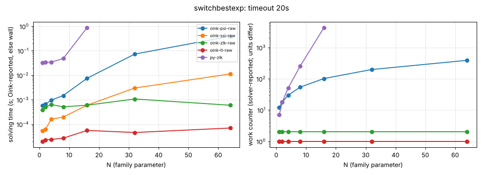
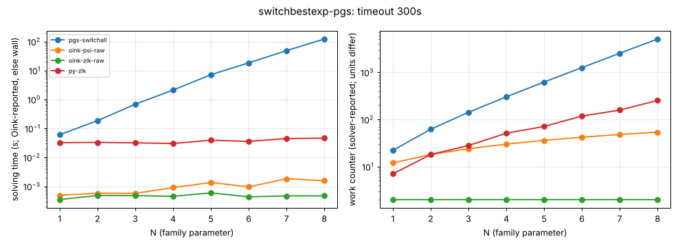

# switchbestexp

**Verdict:** CONFIRMED against the targeted algorithm, run through Python ports: PGSolver's switch-best strategy improvement (pgsolver_si.py --switchbest; port of switch_globally_best.ml with the alternating and cheap-escape transformations; bare SI loop) takes 23, 61, 137, 289, 593, 1201 iterations for N = 1..6 (doubling; table switchbestexp-pgsbest below). Oink psi ~linear (390 at N = 64); ssi, zlk, tl constant. Re-run 2026-10-14 with positional-strategy checks (harness/verify.py): every finishing solver's strategies verified, no disagreement.

- Generator source: github.com/tcsprojects/pgsolver @ d3cd624b61cd66739c45aff9554f6bbdcdd05401, src/lib/generators/policyiter/generators/switchbestexp.ml (Python port)
- Command: `python3 experiments/hard-families/pgsolver_port.py switchbestexp N` (N = family parameter)
- What the source says: ident 'switchbestexp'; its description string (line 79) repeats the switch-all text; target presumably PGSolver's 'switchbest' SI (stratimpralgs/switch_globally_best.ml:119)
- Paper: O. Friedmann, strategy-improvement lower bounds (awaiting source)
- Targeted solvers: PGSolver switchbest SI (not run, see README); contrast: oink-psi-raw, oink-ssi-raw, oink-zlk-raw, oink-tl-raw
- Agreement: every solver that finished on an instance gave the same winner on every vertex (py-zlk, the independent Python Zielonka, included while it finished). Run statuses: ok 33, skipped 1, timeout 1.
- Re-run: `experiments/hard-families/run_all.sh switchbestexp` (Oink built by scripts/setup_oink.sh).

## Growth over the last finished sizes
b: fitted base of work ~ b^N; k: fitted exponent of work ~ n^k (n = vertices). An exponential family shows k rising with N and b > 1 stable; a polynomial one shows b -> 1.

| solver | sizes N | b (per +1 in N) | k (in n) | work at largest N |
|---|---|---|---|---|
| py-zlk | 2..16 | 1.470 | 2.83 | 4329 iterations |
| oink-psi-raw | 8..64 | 1.034 | 0.97 | 390 major iterations |
| oink-ssi-raw | 8..64 | 1.000 | 0.00 | 1 major iterations |
| oink-zlk-raw | 8..64 | 1.000 | 0.00 | 2 iterations |
| oink-tl-raw | 8..64 | 1.000 | 0.00 | 1 iterations |

## Sweep table

| N | n | m | d | oink-psi-raw (major iterations) | oink-ssi-raw (major iterations) | oink-zlk-raw (iterations) | oink-tl-raw (iterations) | py-zlk (iterations) |
|---|---|---|---|---|---|---|---|---|
| 1 | 35 | 70 | 34 | 12 / 0.00058 | 1 / 5.5e-05 | 2 / 0.000384 | 1 / 2e-05 | 7 / 0.0319 |
| 2 | 60 | 130 | 60 | 18 / 0.000658 | 1 / 6.1e-05 | 2 / 0.0005 | 1 / 2.3e-05 | 18 / 0.0342 |
| 4 | 110 | 250 | 110 | 30 / 0.000969 | 1 / 0.000162 | 2 / 0.000637 | 1 / 2.4e-05 | 51 / 0.0346 |
| 8 | 210 | 490 | 210 | 54 / 0.00149 | 1 / 0.000196 | 2 / 0.000514 | 1 / 2.7e-05 | 253 / 0.0482 |
| 16 | 410 | 970 | 410 | 102 / 0.00753 | 1 / 0.000601 | 2 / 0.0006 | 1 / 5.6e-05 | 4329 / 0.883 |
| 32 | 810 | 1930 | 810 | 198 / 0.0735 | 1 / 0.00302 | 2 / 0.00108 | 1 / 4.6e-05 | timeout |
| 64 | 1610 | 3850 | 1610 | 390 / 0.392 | 1 / 0.0113 | 2 / 0.000598 | 1 / 7e-05 | skipped |

## Targeted algorithm (ported): switchbestexp-pgs

Family switchbestexp-pgs; generator `python3 pgsolver_port.py switchbestexp {N}`; timeout 300s per run; cell = iterations / wall seconds (iterations as reported by the solver; '-' if it reports none).

| N | n | m | d | pgs-switchall (iterations) | oink-psi-raw (major iterations) | oink-zlk-raw (iterations) | py-zlk (iterations) |
|---|---|---|---|---|---|---|---|
| 1 | 35 | 70 | 34 | 22 / 0.0604 | 12 / 0.000487 | 2 / 0.000349 | 7 / 0.0321 |
| 2 | 60 | 130 | 60 | 62 / 0.185 | 18 / 0.000578 | 2 / 0.000482 | 18 / 0.0329 |
| 3 | 85 | 190 | 84 | 142 / 0.686 | 24 / 0.00057 | 2 / 0.000476 | 28 / 0.0316 |
| 4 | 110 | 250 | 110 | 302 / 2.12 | 30 / 0.000898 | 2 / 0.00045 | 51 / 0.0302 |
| 5 | 135 | 310 | 134 | 622 / 7.15 | 36 / 0.00135 | 2 / 0.000594 | 71 / 0.039 |
| 6 | 160 | 370 | 160 | 1262 / 18.4 | 42 / 0.000957 | 2 / 0.000432 | 118 / 0.0356 |
| 7 | 185 | 430 | 184 | 2542 / 48.6 | 48 / 0.00182 | 2 / 0.000466 | 158 / 0.0446 |
| 8 | 210 | 490 | 210 | 5102 / 123 | 54 / 0.00156 | 2 / 0.000467 | 253 / 0.0461 |

