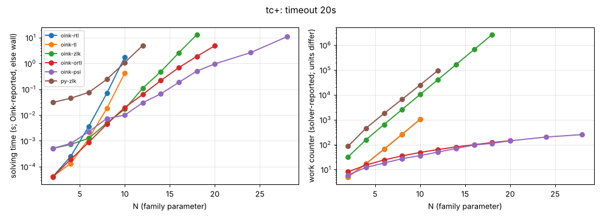

# tc+

**Verdict:** CONFIRMED. rtl (the target) and tl grow by b = 1.98, zlk by 2.00; contrast ortl (b = 1.10) and psi (1.08) stay polynomial (psi times out only at N = 32, 33984 vertices). Re-run 2026-10-14 with positional-strategy checks (harness/verify.py): every finishing solver's strategies verified, no disagreement.

- Generator source: github.com/trolando/oink @ 8fbf0a7c3e5b0baa254cb4516258c5c42fa99db1, src/tools/tc+.cpp
- Command: `tools/oink/build/tc+ N` (N = family parameter)
- What the source says: Oink README.md:200: 'TC modified to defeat the RTL solver'
- Paper: none given in the repository (awaiting source)
- Targeted solvers: oink-rtl, oink-tl, oink-zlk; contrast: oink-ortl, oink-psi
- Agreement: every solver that finished on an instance gave the same winner on every vertex (py-zlk, the independent Python Zielonka, included while it finished). Run statuses: ok 47, skipped 19, timeout 5.
- Re-run: `experiments/hard-families/run_all.sh tc+` (Oink built by scripts/setup_oink.sh).

## Growth over the last finished sizes
b: fitted base of work ~ b^N; k: fitted exponent of work ~ n^k (n = vertices). An exponential family shows k rising with N and b > 1 stable; a polynomial one shows b -> 1.

| solver | sizes N | b (per +1 in N) | k (in n) | work at largest N |
|---|---|---|---|---|
| oink-zlk | 12..18 | 2.000 | 3.55 | 2621464 iterations |
| oink-rtl | 4..10 | 1.981 | 1.68 | 1025 iterations |
| oink-tl | 4..10 | 1.981 | 1.68 | 1025 iterations |
| py-zlk | 6..12 | 1.943 | 2.07 | 95779 iterations |
| oink-ortl | 14..20 | 1.102 | 0.56 | 143 iterations |
| oink-psi | 18..28 | 1.084 | 0.62 | 251 major iterations |

## Sweep table

| N | n | m | d | oink-rtl (iterations) | oink-tl (iterations) | oink-zlk (iterations) | oink-ortl (iterations) | oink-psi (major iterations) | py-zlk (iterations) |
|---|---|---|---|---|---|---|---|---|---|
| 2 | 24 | 38 | 15 | 5 / 4.1e-05 | 5 / 4.1e-05 | 32 / 0.000505 | 8 / 4e-05 | 6 / 0.000511 | 85 / 0.0306 |
| 4 | 104 | 196 | 27 | 17 / 0.000251 | 17 / 0.000134 | 156 / 0.000728 | 15 / 0.000191 | 12 / 0.000787 | 455 / 0.0447 |
| 6 | 288 | 570 | 39 | 65 / 0.00363 | 65 / 0.00124 | 640 / 0.00125 | 24 / 0.000881 | 18 / 0.00225 | 1777 / 0.0752 |
| 8 | 624 | 1256 | 51 | 257 / 0.0694 | 257 / 0.0179 | 2564 / 0.00491 | 35 / 0.00442 | 27 / 0.0073 | 6565 / 0.24 |
| 10 | 1160 | 2350 | 63 | 1025 / 1.76 | 1025 / 0.425 | 10248 / 0.0168 | 48 / 0.0197 | 36 / 0.00992 | 24731 / 1.08 |
| 12 | 1944 | 3948 | 75 | timeout | timeout | 40972 / 0.111 | 63 / 0.0625 | 50 / 0.03 | 95779 / 4.97 |
| 14 | 3024 | 6146 | 87 | skipped | skipped | 163856 / 0.478 | 80 / 0.216 | 69 / 0.066 |  |
| 16 | 4448 | 9040 | 99 | skipped | skipped | 655380 / 2.56 | 99 / 0.684 | 96 / 0.183 |  |
| 18 | 6264 | 12726 | 111 | skipped | skipped | 2621464 / 13 | 120 / 1.87 | 112 / 0.503 |  |
| 20 | 8520 | 17300 | 123 | skipped | skipped | timeout | 143 / 4.82 | 141 / 0.954 |  |
| 24 | 14544 | 29496 | 147 | skipped | skipped | skipped | timeout | 200 / 2.63 |  |
| 28 | 22904 | 46396 | 171 | skipped | skipped | skipped | skipped | 251 / 10.7 |  |
| 32 | 33984 | 68768 | 195 | skipped | skipped | skipped | skipped | timeout |  |

