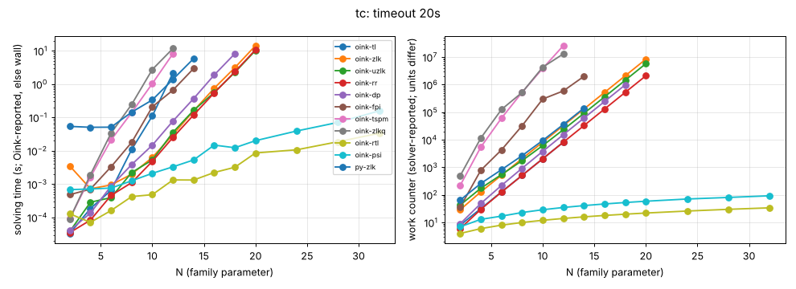

# tc

**Verdict:** CONFIRMED. Exponential for the targets: tl, zlk, uzlk, rr, dp grow by b = 2.00 per +1 in N (fpi 1.92, tspm 2.74, zlkq 2.23 over shorter ranges; zlkq is claimed quasi-polynomial by Oink, which our range cannot separate from exponential). Contrast rtl and psi stay polynomial (b = 1.04, work ~ n^0.5) up to N = 32 (3232 vertices). Re-run 2026-10-14 with positional-strategy checks (harness/verify.py): every finishing solver's strategies verified, no disagreement.

- Generator source: github.com/trolando/oink @ 8fbf0a7c3e5b0baa254cb4516258c5c42fa99db1, src/tools/tc.cpp
- Command: `tools/oink/build/tc N` (N = family parameter)
- What the source says: Oink README.md:199-219: 'Two binary counters ... exponential lower bound for many algorithms' (TL, FPI/FPJ/FPJG, NPP/PP/PPP/DP/RRDP, ZLK/UZLK/ZLKPP-STD, TSPM/SPM/MSPM); quasi-polynomial for ZLKQ/ZLKPP-WAW/ZLKPP-LIV/SSPM/QPT; polynomial for RTL/ORTL/PTL/SPPTL/DTL/IDTL/PSI
- Paper: T. van Dijk, A Parity Game Tale of Two Counters, GandALF 2019, doi:10.4204/EPTCS.305.8 (awaiting source)
- Targeted solvers: oink-tl, oink-zlk, oink-uzlk, oink-rr, oink-dp, oink-fpi, oink-tspm, oink-zlkq; contrast: oink-rtl, oink-psi
- Agreement: every solver that finished on an instance gave the same winner on every vertex (py-zlk, the independent Python Zielonka, included while it finished). Run statuses: ok 97, skipped 36, timeout 9.
- Re-run: `experiments/hard-families/run_all.sh tc` (Oink built by scripts/setup_oink.sh).

## Growth over the last finished sizes
b: fitted base of work ~ b^N; k: fitted exponent of work ~ n^k (n = vertices). An exponential family shows k rising with N and b > 1 stable; a polynomial one shows b -> 1.

| solver | sizes N | b (per +1 in N) | k (in n) | work at largest N |
|---|---|---|---|---|
| oink-tspm | 6..12 | 2.742 | 4.74 | 25938757 lifts |
| oink-zlkq | 6..12 | 2.231 | 3.78 | 13025476 iterations |
| oink-dp | 12..18 | 2.001 | 5.40 | 982882 promotions |
| oink-rr | 14..20 | 2.000 | 6.10 | 2097150 promotions |
| oink-tl | 6..12 | 2.000 | 3.25 | 8192 iterations |
| oink-zlk | 14..20 | 2.000 | 6.10 | 8388641 iterations |
| oink-uzlk | 14..20 | 1.996 | 6.08 | 5769223 iterations |
| py-zlk | 8..14 | 1.939 | 3.79 | 140699 iterations |
| oink-fpi | 8..14 | 1.922 | 3.80 | 2000320 iterations |
| oink-psi | 20..32 | 1.038 | 0.49 | 93 major iterations |
| oink-rtl | 20..32 | 1.037 | 0.48 | 34 iterations |

## Sweep table

| N | n | m | d | oink-tl (iterations) | oink-zlk (iterations) | oink-uzlk (iterations) | oink-rr (promotions) | oink-dp (promotions) | oink-fpi (iterations) | oink-tspm (lifts) | oink-zlkq (iterations) | oink-rtl (iterations) | oink-psi (major iterations) | py-zlk (iterations) |
|---|---|---|---|---|---|---|---|---|---|---|---|---|---|---|
| 2 | 22 | 36 | 11 | 8 / 3.3e-05 | 29 / 0.00349 | 43 / 3.8e-05 | 6 / 3.5e-05 | 9 / 4.1e-05 | 36 / 0.000481 | 221 / 9.2e-05 | 496 / 9.1e-05 | 4 / 0.000128 | 7 / 0.000681 | 65 / 0.0538 |
| 4 | 68 | 128 | 19 | 32 / 0.000185 | 129 / 0.000725 | 175 / 0.000285 | 30 / 8.3e-05 | 49 / 0.000135 | 787 / 0.000706 | 5449 / 0.00162 | 11571 / 0.00191 | 6 / 7.1e-05 | 13 / 0.000713 | 261 / 0.0506 |
| 6 | 138 | 276 | 27 | 128 / 0.000647 | 517 / 0.000941 | 545 / 0.000393 | 126 / 0.000457 | 220 / 0.00087 | 4284 / 0.0033 | 60768 / 0.0211 | 125167 / 0.0339 | 8 / 0.000161 | 17 / 0.00076 | 819 / 0.051 |
| 8 | 232 | 480 | 35 | 512 / 0.0109 | 2057 / 0.00199 | 1747 / 0.00223 | 510 / 0.00111 | 927 / 0.00385 | 32220 / 0.0179 | 524557 / 0.14 | 520204 / 0.246 | 10 / 0.000422 | 23 / 0.00126 | 2657 / 0.144 |
| 10 | 350 | 740 | 43 | 2048 / 0.111 | 8205 / 0.00629 | 6157 / 0.00529 | 2046 / 0.00481 | 3790 / 0.0147 | 300449 / 0.208 | 3882653 / 1.04 | 4290402 / 2.74 | 12 / 0.000481 | 29 / 0.0021 | 9447 / 0.335 |
| 12 | 492 | 1056 | 51 | 8192 / 2.16 | 32785 / 0.0304 | 23279 / 0.0357 | 8190 / 0.0251 | 15289 / 0.0778 | 591355 / 0.66 | 25938757 / 8.18 | 13025476 / 11.7 | 14 / 0.00133 | 35 / 0.0033 | 35877 / 1.39 |
| 14 | 658 | 1428 | 59 | timeout | 131093 / 0.157 | 91129 / 0.163 | 32766 / 0.118 | 61344 / 0.366 | 2000320 / 2.93 | timeout | timeout | 16 / 0.00132 | 41 / 0.00529 | 140699 / 5.81 |
| 16 | 848 | 1856 | 67 | skipped | 524313 / 0.751 | 361771 / 0.559 | 131070 / 0.546 | 245635 / 1.88 | timeout | skipped | skipped | 18 / 0.00222 | 47 / 0.0148 | timeout |
| 18 | 1062 | 2340 | 75 | skipped | 2097181 / 3.11 | 1443461 / 2.25 | 524286 / 2.33 | 982882 / 8.18 | skipped | skipped | skipped | 20 / 0.0032 | 53 / 0.0123 | skipped |
| 20 | 1300 | 2880 | 83 | skipped | 8388641 / 14.3 | 5769223 / 10.2 | 2097150 / 10.7 | timeout | skipped | skipped | skipped | 22 / 0.00857 | 59 / 0.02 | skipped |
| 24 | 1848 | 4128 | 99 | skipped | timeout | timeout | timeout | skipped | skipped | skipped | skipped | 26 / 0.0107 | 71 / 0.0392 | skipped |
| 28 | 2492 | 5600 | 115 | skipped | skipped | skipped | skipped | skipped | skipped | skipped | skipped | 30 / 0.0187 | 81 / 0.0709 | skipped |
| 32 | 3232 | 7296 | 131 | skipped | skipped | skipped | skipped | skipped | skipped | skipped | skipped | 34 / 0.0335 | 93 / 0.157 |  |

